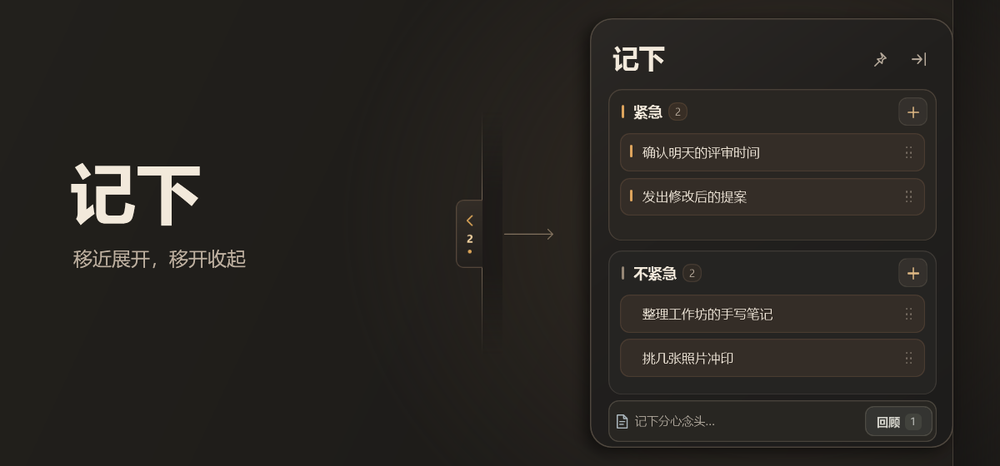
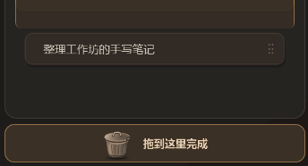
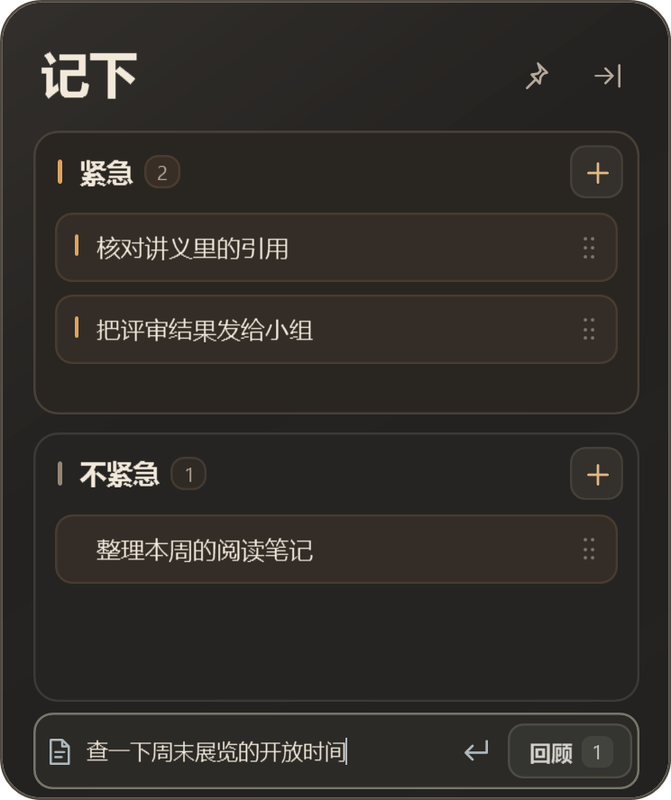
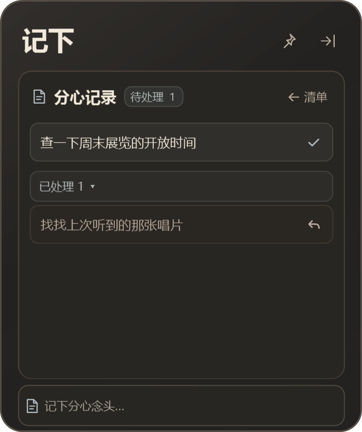
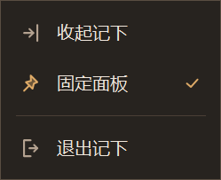

# 记下

一份贴在 Windows 屏幕右侧的待办清单。先看眼下要紧的事，临时想查的东西留到忙完再看。

**[下载记下.exe](outputs/记下.exe?raw=true)**　·　[看操作动图](outputs/记下操作演示.gif)　·　双击运行，需 .NET Framework 4.8



## 待办越写越长，先做哪件？

点 `＋` 写下待办，把最急的几件拖进「紧急」。收起清单，把手上的数字就是剩余急事数。做完拖进垃圾桶，5 秒内可撤销。



## 工作到一半，突然想查个东西？

比如想查周末展览几点开门，先在底栏记一句，按回车继续工作。忙完点「回顾」，想查的事都在这里，可以逐条勾掉。

<p>
  
  
</p>

<details>
<summary>托盘菜单、本地数据与构建</summary>

右键系统托盘里的「记下」可以固定面板或退出。升级时先退出旧版。任务和分心记录保存在 `%LOCALAPPDATA%\SidePage`。



从项目根目录用 PowerShell 构建，程序输出到 `outputs\记下.exe`。

```powershell
.\src\build.ps1
```

验收脚本见 [qa](qa)。

</details>
